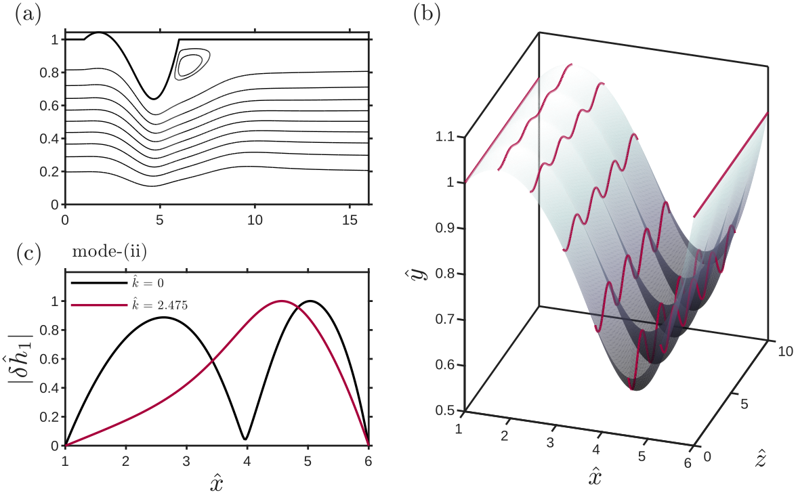

My research focuses on flows through collapsible channels: problems in which a fluid interacts nonlinearly with an elastic solid. I am mainly interested in the numerical modelling of these systems, aiming to capture their dynamical behaviour, study the effect of system parameters, and characterise the physical phenomena that emerge.

## My thesis
**Dynamical Analysis of Collapsible Channels with Hyperelastic Walls** (*in progress*)  
Supervisors: Prof. Alfonso Miguel Gañán Calvo, Prof. Miguel Ángel Herrada Gutierrez — University of Sevilla

*Abstract:* We present a numerical study of collapsible channels with different geometries. We analyse and characterise families of steady solutions and investigate their linear stability under variations in physical parameters. The computations are carried out using JaM, a numerical framework based on the use of analytical Jacobians and sparse collocation matrices, which allows the modelling of fluid–solid interaction problems under large deformations.


[Download PDF](research/thesis/thesis.pdf){.btn .btn-primary} 
[Browse HTML version](research/thesis/){.btn .btn-outline-primary}

::: {.callout-note}
## Coming soon (hopefully)
Interactive HTML version built with Quarto — providing browsable chapters with embedded figures and code.
:::


## Publications

### Journal articles

::: {.pub-entry}
[ E. G. Herrer]{.pub-authors},  M. A. Herrada, A. M. Gañán-Calvo, P. S. Stewart. 
[**Stability of finite-length collapsible channel flow to spanwise perturbations**]{.pub-title}. 
[*Physics of Fluids*, 36, 124105 (2024).]{.pub-venue}  
[[PDF]](https://pubs.aip.org/aip/pof/article-pdf/doi/10.1063/5.0237604/20279061/124105_1_5.0237604.pdf) [[DOI]](https://doi.org/10.1063/5.0237604) 

{width=70% fig-align="left" fig-alt="Representative figure from the paper"}
:::

### Under review

::: {.pub-entry}
[E. G. Herrer]{.pub-authors}, M. A. Herrada, A. M. Gañán-Calvo. 
[**Global stability analysis of axisymmetric flow in a collapsible tube**]{.pub-title}. 
[Revised manuscript submitted to *Physics of Fluids*; awaiting editorial decision.]{.pub-venue}

```{=html}
<video controls autoplay loop muted playsinline style="width:70%;">
  <source src="research/pictures/axi_oscillations.mp4" type="video/mp4">
</video>
```
:::


## Funded Research Projects

**2023–2026 — [Física de fluidos extrema a escalas pequeñas con superficies libres: fenómenos singulares y aplicaciones críticas](https://prisma.us.es/financiacion/16624)**  
Reference: PID2022-140951OB-C21 · Funding: Ministerio de Ciencia e Innovación · Recorded role: Researcher (*Investigador/a*).

**2020–2023 — [Física y Modelización de la Micro- y Meso-Escala en Flujos con Entrefases para el Avance de Tecnologías Vitales](https://prisma.us.es/financiacion/3385)**  
Reference: PID2019-108278RB-C31 · Funding: Ministerio de Ciencia, Innovación y Universidades · Recorded role: Contracted staff (*Contratado*).

**2024–2026 — [ASTER+S: Art-Science-Technology-Engineering Research for + with Society: Transdisciplinary Methodologies and Practices to foster cross-pollination and innovation](https://prisma.us.es/financiacion/17659)**  
Reference: FCT-23-19716 · Funding: Ministerio de Ciencia, Innovación y Universidades · Recorded role: Researcher (*Investigador/a*).

*The dates shown are project periods, not necessarily individual participation dates. Roles are those recorded in PRISMA.*


## Talks & Presentations

| Date | Event | Title |
|------|-------|-------|
| Nov 2025 | Informal Applied, University of Manchester | Wrinkles to Drapes in Elastic Discs |
| Nov 2024 | Euro Mech, University of Aachen | Stability of a finite-length collapsible channel flow to spanwise perturbations |
| Jul 2024 | Seminar, IIT-Bombay | Fluid–solid interaction model in collapsible channels and potential applications to filtering systems |


## Schools & Advanced Training

- **2024 — CISM Advanced Course: *Drops, Jets and Films*.** International Centre for Mechanical Sciences (CISM), Udine, Italy, 6–10 May 2024.
- **2023 — Ulysseus Spring School in PDEs (USSPDE).** Seville, Spain, 12–16 June 2023.
